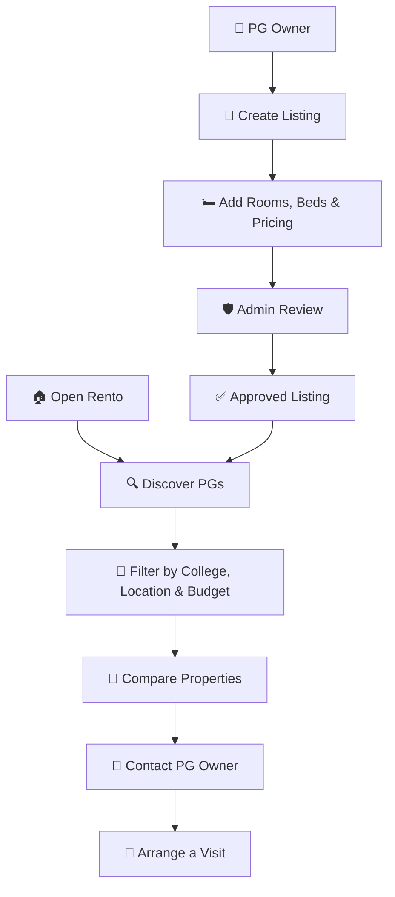

# 🏠 Rento — Find Your Stay. Manage Your Space.

> 🎓 Finding a PG shouldn't feel harder than finding a job!

**Rento** is a student accommodation discovery marketplace and PG management SaaS designed to connect students with paying guest accommodations near colleges across Bengaluru. It also helps PG owners manage property listings, room availability, bed inventory, and student enquiries.

🔗 **Live Demo:** [rentoai.vercel.app](https://rentoai.vercel.app/)

---

## ✨ Features

### 🎓 For Students
- 🔍 Discover PGs by college, location, budget, and amenities.
- 🏡 Explore property details, photos, room types, and pricing.
- ⚖️ Compare accommodations side by side.
- ❤️ Save favourite properties.
- 📩 Send enquiries and manage visit requests.

### 🏢 For PG Owners
- 📝 Create and manage PG listings.
- 🛏️ Track room capacity and available beds.
- 📸 Manage property photographs and amenities.
- 📬 View and respond to student enquiries.
- 📊 Monitor listings through an owner dashboard.

### 🛡️ For Administrators
- Review submitted property listings.
- Approve or reject listings with reasons.
- Manage publication and verification status.

---

## 🛠️ Tech Stack

| Technology | Purpose |
|---|---|
| React 18 | Frontend UI |
| Vite | Development server and build tool |
| TypeScript | Type-safe development |
| Tailwind CSS | Responsive styling |
| React Router | Client-side navigation |
| Framer Motion | UI animations and transitions |
| Lucide React | Icons |
| Supabase | Authentication, database, and storage |

---

## 🚀 Getting Started

### Prerequisites

- Node.js 18 or newer
- npm 10 or newer
- Git

### 1. Clone the Repository

```bash
git clone <your-repository-url>
cd <your-project-folder>
```

### 2. Install Dependencies

```bash
npm install
```

### 3. Configure Environment Variables

Create a `.env` file in the project root:

```env
VITE_SUPABASE_URL=https://your-project.supabase.co
VITE_SUPABASE_PUBLISHABLE_KEY=your-publishable-key
```

Configure your Supabase database, authentication, storage, and security policies before using live backend features.

**Never expose your Supabase service-role key in frontend code.**

### 4. Run the Development Server

```bash
npm run dev
```

Open the local URL shown in your terminal, usually:

`http://localhost:5173/`

### 5. Build for Production

```bash
npm run build
```

---

## 🔄 How Rento Works



**Student workflow:** Search → Compare → Save → Enquire → Visit.

**Owner workflow:** Register → List Property → Manage Beds → Receive Enquiries.

**Admin workflow:** Review → Approve or Reject → Manage Listings.

---

## 😂 Rento Memes

### Meme 1: The Student PG Search

**Expectation:**
> "I'll find a good PG in 10 minutes."

**Reality:**
> 47 tabs open. 23 phone calls. 0 matching photos. 💀

**Rento:**
> One platform. Compare your options. Find your stay. 🏠

---

### Meme 2: The PG Owner

**Before Rento:**
> "Bhai, bed vacant hai kya? Rent kitna hai? Food included hai?" 😭

**After finding the right listing:**
> "All the details are in one place." 😎

---

### Meme 3: The College Distance

**PG listing:** "Just 5 minutes from college!"

**Google Maps:** "5 minutes by aircraft." ✈️💀

**Rento:** Check the location before you book. 📍

---

## 🎯 Project Goal

Rento aims to make student accommodation discovery more convenient while helping PG owners manage their properties efficiently. The platform brings property search, room information, pricing, bed availability, and enquiries into one experience.

The long-term goal is to build a sustainable accommodation marketplace with useful tools for both students and property owners.

---

## 📌 Project Status

Rento supports a frontend demo and is designed for Supabase integration. Available functionality depends on the configured backend and deployment environment. Proposed subscription plans are not proof of active payment processing.

---

**Made with ❤️ for students looking for a place to call home.**

### Rento — Find Your Stay. Manage Your Space.